<div align="center">

# 🚚 SwiftTrack

### Middleware that makes a SOAP legacy system, a REST cloud service and a proprietary TCP warehouse system work as one real-time logistics platform


[](https://github.com/gayashan-indrasankha/Middleware-Architecture-for-SwiftLogistics/actions/workflows/e2e.yml)

<br>

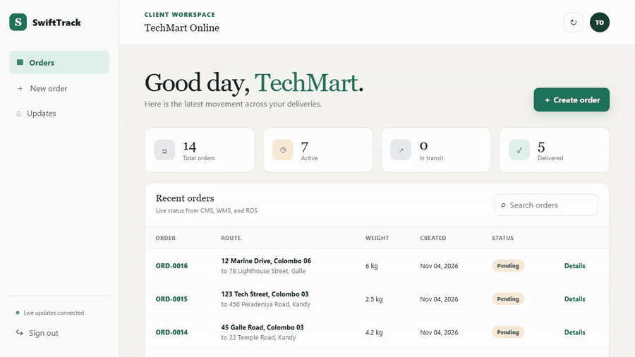

<sub><b>Real recording of the running system.</b> One order goes through three backend systems, and each step reaches the browser over WebSocket.</sub>

</div>

---

## ⚡ The 30-second summary

| | |
|---|---|
| **What it is** | An integration platform for a fictional logistics company whose three core systems speak incompatible protocols. Clients and drivers get one clean API and live updates. |
| **Why it's hard** | One order is a *distributed transaction* across SOAP/XML, REST and raw TCP, with no shared protocol and services that can go down independently. |
| **My role** | **Integration & QA engineer** in a team of six (university module IS3208, Middleware Architecture). I got the separately built services working together, wrote the end-to-end test suite, and found and fixed the cross-service bugs that blocked the core flow. |
| **Proof it works** | 24 automated checks run on every pull request, and a saga finishes in under 50 ms on a local run. Orders created during a backend outage [finish processing when it recovers](#-verified-behaviour). |

### What this project shows about me

| Skill | Where you can see it |
|---|---|
| **Debugging across service boundaries** | Traced a stalled transaction to a mismatch between what one service published and what another expected ([details](#-my-contribution-integration-testing--bug-fixing)) |
| **Test automation** | A scripted [E2E suite](tests/e2e.ps1) covering login → order → saga → route → warehouse → delivery → failure, running in CI |
| **Distributed systems** | Saga pattern, publish/subscribe, durable messaging, eventual consistency |
| **Multi-tenant awareness** | Scoped events that were reaching every connected client to the right recipient, with a [test](tests/ws-isolation.mjs) that proves it |
| **Infrastructure** | Docker Compose health-check tuning to make cold starts reliable |
| **Engineering honesty** | A public [list of known limitations](#-known-limitations--what-id-do-next) with the production fix for each |

---

## 🧩 The problem

SwiftLogistics runs three systems that can't talk to each other:

| System | Protocol | Job |
|---|---|---|
| **CMS** — Client Management | SOAP / XML | On-prem legacy system: client accounts, authentication, order intake |
| **ROS** — Route Optimisation | REST / JSON | Cloud-style service: plans delivery routes with a nearest-neighbour algorithm |
| **WMS** — Warehouse Management | Proprietary TCP | Tracks packages from warehouse receipt to dispatch |

Without middleware, every frontend would need a SOAP client, a raw TCP client and its own retry logic. SwiftTrack hides all of that behind one REST and WebSocket API.

---

## 🏗️ Architecture

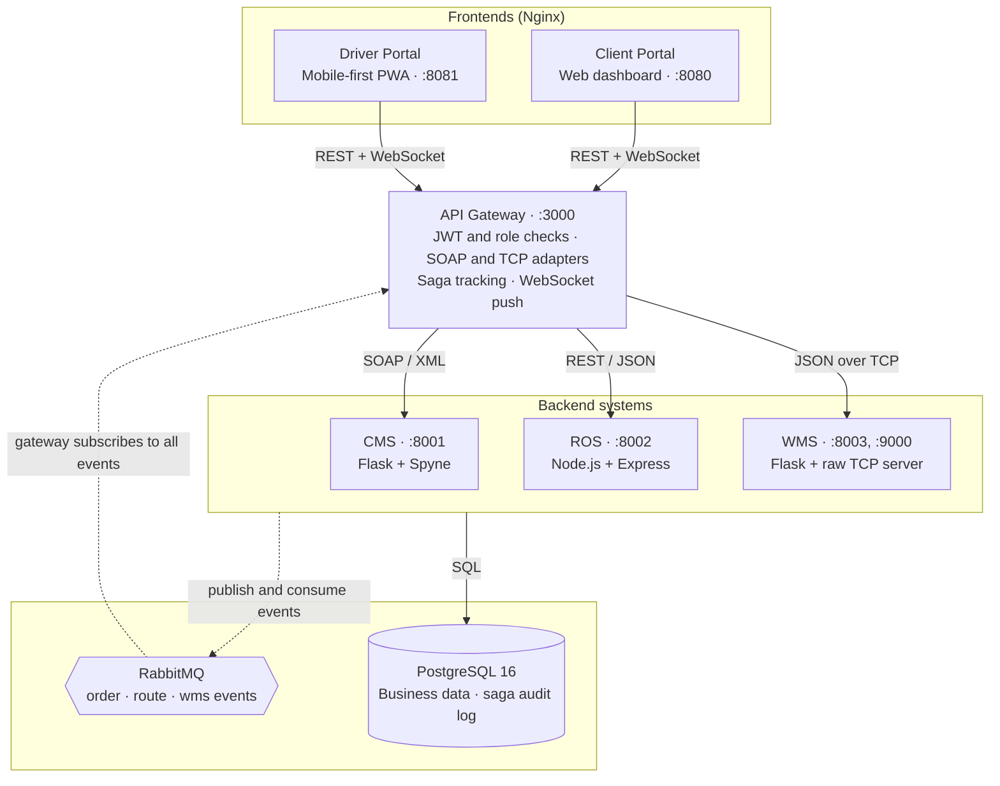

### Patterns used

| Pattern | Why it's here | Where |
|---|---|---|
| **API Gateway** | One entry point for auth, routing and real-time push | `api-gateway/app.js` |
| **Channel Adapter** | Translates REST/JSON to SOAP/XML and TCP, so frontends never see either | `buildSoapEnvelope()`, `sendWmsTcpCommand()` |
| **Publish-Subscribe** | ROS and WMS react to new orders independently, and neither needs to know the other exists | Fanout exchanges in RabbitMQ |
| **Saga** | Tracks one business transaction across services, with a compensation path for failures | `handleSagaEvent()`, `executeSagaCompensation()` |
| **Canonical Data Model** | All services exchange the same JSON shape, whatever their native protocol | `ORDER_CREATED` event payload |

> 📖 More detail on each pattern is in [`ARCHITECTURE.md`](./ARCHITECTURE.md).

---

## 🔄 How one order flows through the system

The client gets an immediate response. Everything after that happens asynchronously and reaches the browser as live events.

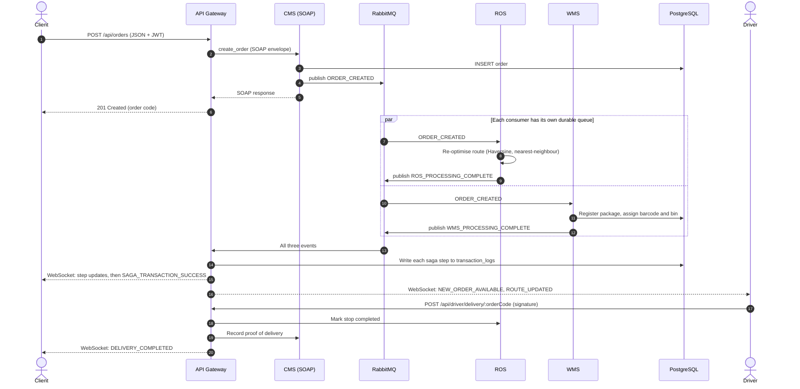

### Saga state machine

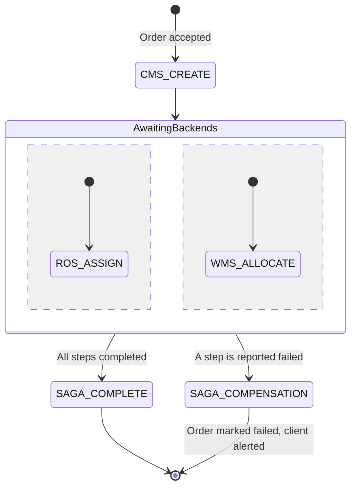

---

## 📸 The running product

*Every image below was captured from this codebase running in Docker. Nothing is mocked up.*

### Client portal

<table>
<tr>
<td width="50%">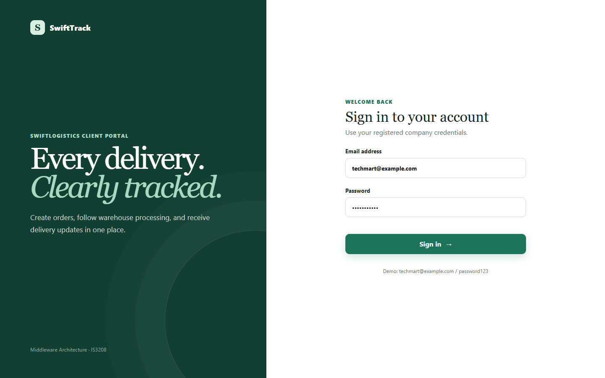<br><sub><b>Sign in.</b> The form posts JSON, and the gateway authenticates against the SOAP service.</sub></td>
<td width="50%">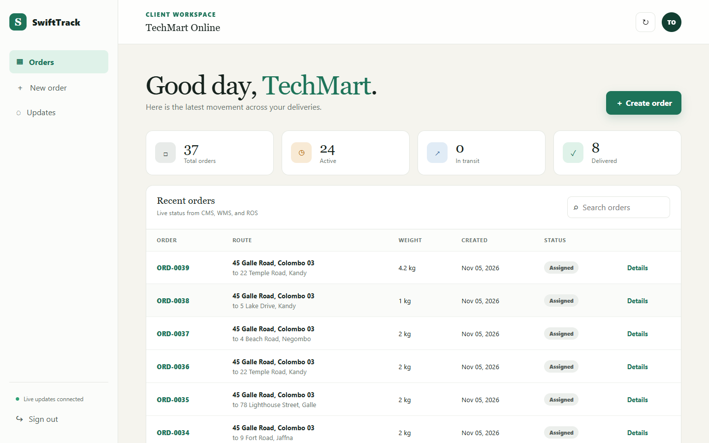<br><sub><b>Dashboard.</b> Each client sees only its own orders and their current status.</sub></td>
</tr>
<tr>
<td>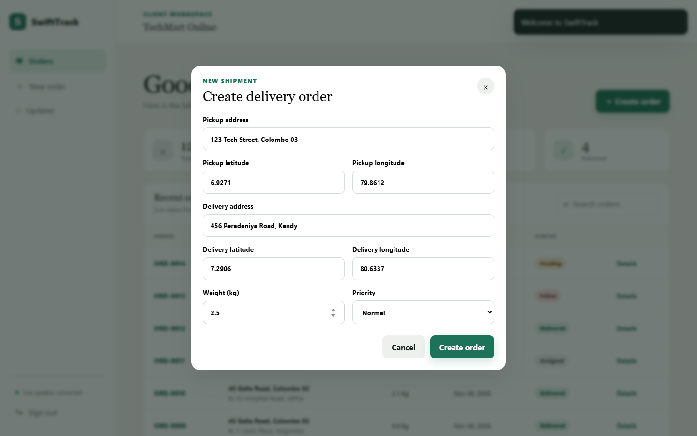<br><sub><b>Create an order.</b> Submitting this starts the distributed transaction.</sub></td>
<td>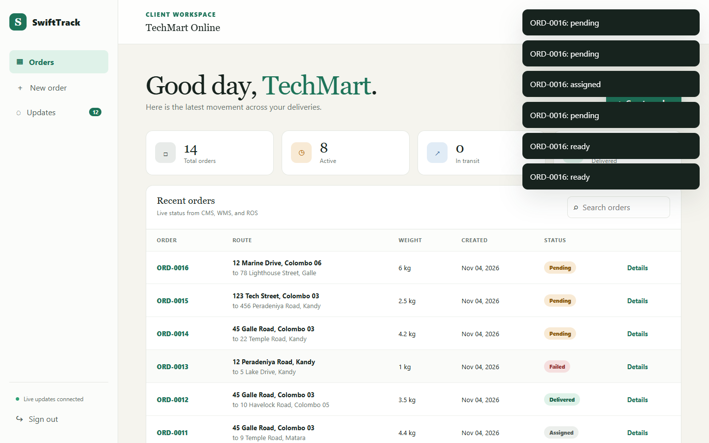<br><sub><b>Live events.</b> Saga steps for one order arrive within milliseconds, with no refresh.</sub></td>
</tr>
<tr>
<td>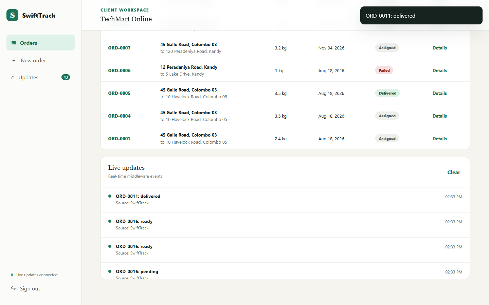<br><sub><b>Closing the loop.</b> When a driver submits proof of delivery, the owning client is told immediately.</sub></td>
<td>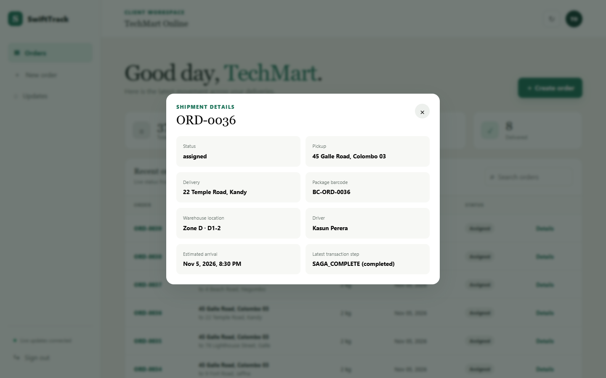<br><sub><b>One view of three systems.</b> Warehouse, route and saga data for a single order.</sub></td>
</tr>
</table>

### Driver portal

<table>
<tr>
<td width="68%">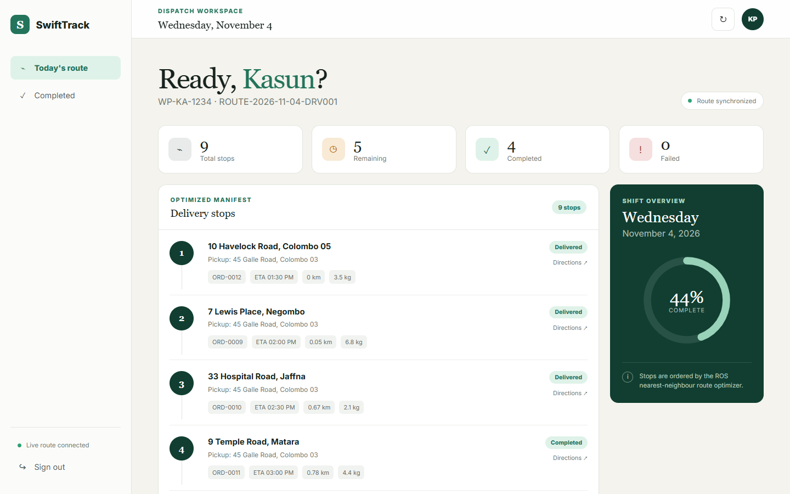<br><sub><b>Optimised route.</b> Stops in ROS order, with ETAs, distances and shift progress.</sub><br><br>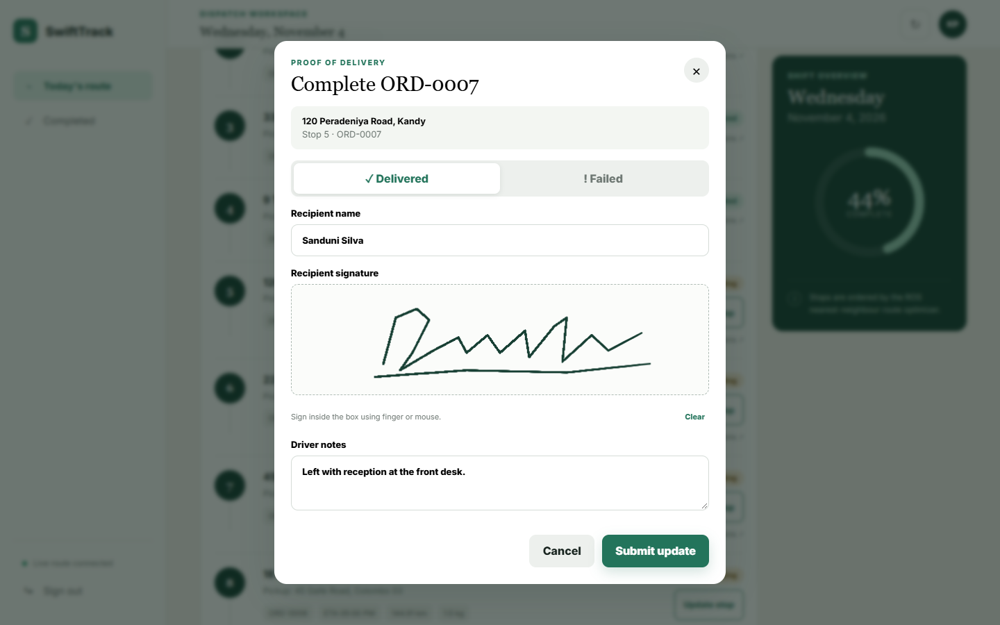<br><sub><b>Proof of delivery.</b> Recipient name and a canvas signature, or a reason code if the delivery failed.</sub><br><br>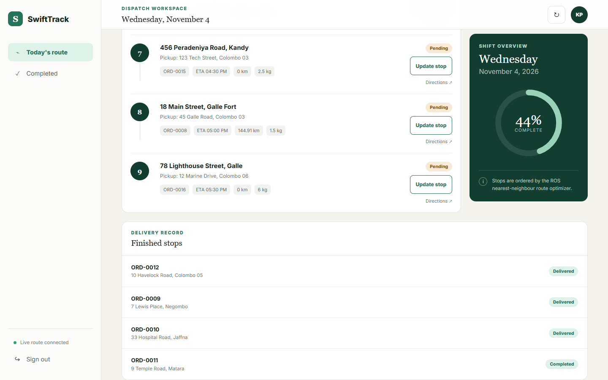<br><sub><b>Delivery record.</b> Finished stops, with shift progress updated.</sub></td>
<td width="32%" valign="top">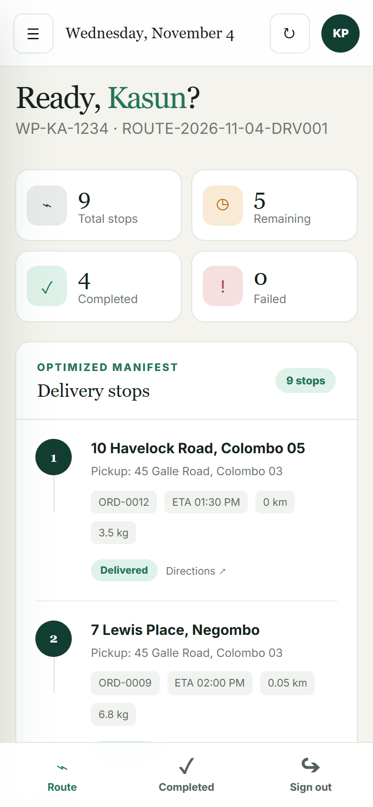<br><sub><b>Built for the road.</b> Mobile-first PWA with bottom navigation, a service worker and a web app manifest for Add to Home Screen.</sub></td>
</tr>
</table>

### Messaging layer

<table>
<tr>
<td width="50%">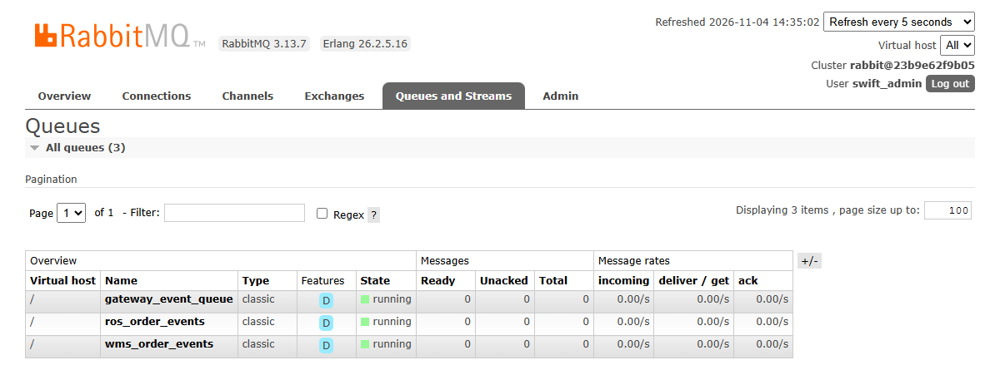<br><sub><b>Queues.</b> Each consumer has its own durable queue (the "D" flag).</sub></td>
<td width="50%">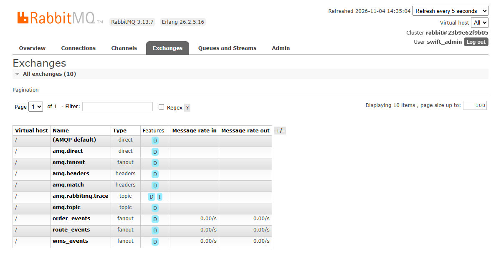<br><sub><b>Exchanges.</b> Three durable fanout exchanges, one per event family.</sub></td>
</tr>
</table>

---

## 🎯 My contribution: integration, testing & bug fixing

Each service worked on its own. The hard part was making them work **together**. My work was [Phase 6](https://github.com/gayashan-indrasankha/Middleware-Architecture-for-SwiftLogistics/commit/2325a68): building the whole stack, running the complete business flow, and fixing what broke at the seams.

### 🐛 Bug 1: Sagas could never complete

**Symptom:** orders were processed by every backend, but the transaction never reached `SAGA_COMPLETE`, and clients never got the success event.

**Root cause:** a contract mismatch between two services that was invisible when testing either one alone. The gateway expected every event to carry a top-level `order_code`, but ROS publishes its *entire route*, with order codes nested inside `stops[]`:

```jsonc
// What the gateway looked for     // What ROS actually publishes
{ "data": { "order_code": "…" } }  { "data": { "route_id": "…", "stops": [ { "order_code": "…" } ] } }
```

So the handler hit `if (!orderCode) return;` and **silently dropped the event**. There was no error and no log line, just a transaction that never finished.

**Fix:** I handled the route-shaped event explicitly. The gateway now walks `stops[]`, matches each stop to its active saga, skips steps already recorded, and runs the completion check for each stop.

```js
if (eventType === 'ROS_PROCESSING_COMPLETE') {
  for (const stop of data.stops ?? []) {
    const saga = activeSagas.get(stop.order_code);
    if (!saga || saga.steps.ROS_ASSIGN === 'completed') continue;   // safe to see twice
    saga.steps.ROS_ASSIGN = 'completed';
    await logSagaStep(stop.order_code, 'ROS_ASSIGN', 'completed', stop);
    // …notify the client and driver, then check whether the saga is complete
  }
  return;
}
```

<sub>Simplified from `handleSagaEvent()` in `api-gateway/app.js`.</sub>

**What I took from it:** integration bugs live in the assumptions between services, which is why silent early returns in event handlers are dangerous and why I wrote an end-to-end suite rather than more isolated tests.

### 🔒 Bug 2: Delivery events reached every connected user

**Problem:** `DELIVERY_COMPLETED` was broadcast to every open WebSocket, so **one client company could see another's delivery activity**. In a multi-tenant system that's a data-isolation bug, not just noise.

**Fix:** the gateway now looks up the order's owner and sends the event only to that client's sockets, with a separate confirmation to the driver who made the delivery.

### 🐳 Bug 3: Unreliable cold starts

**Problem:** RabbitMQ can take a long time to boot from a cold start, and its health check allowed only 10 seconds of start-up grace. Every service depends on the broker, so `docker compose up` was at the mercy of start-up timing.

**Fix:** I widened the health check (timeout 5 s → 10 s, retries 10 → 20, start period 10 s → 120 s), so dependent services wait for a broker that is really ready.

### 🔧 Also fixed: driver stop lookup

The delivery endpoint now matches a stop on either `order_code` or `order_id`. Previously, `order_id` was never checked when a stop also had an `order_code`.

### 🧪 End-to-end test suite

I wrote a [PowerShell E2E suite](tests/e2e.ps1) that drives the system through its public API, exactly as a real client and driver would:

```mermaid
flowchart LR
    A[Health] --> B[Client login<br/>via SOAP] --> C[Create order] --> D[Poll until<br/>assigned]
    D --> E[Check saga<br/>audit log] --> F[Driver login] --> G[Fetch route]
    G --> H[Update package<br/>via TCP] --> I[Deliver with<br/>signature] --> J[Verify<br/>delivered]
    J --> K[Inject failure] --> L[Verify<br/>compensation] --> M[Re-sequence<br/>route]
```

### 🛠️ Later fixes

Writing down the project's known limitations led to a second round of fixes. Each one has a test that failed before the fix:

| Problem | Fix | Test |
|---|---|---|
| Re-sequencing a route violated a unique constraint, which left new orders `pending` after their saga completed | [Save the whole route in one locked transaction](ros-service/app.js) | [`tests/e2e.ps1`](tests/e2e.ps1), step 11 |
| Other clients received new-order, route and package events that weren't theirs | [Remove the broadcast fallback and target each event](api-gateway/app.js) | [`tests/ws-isolation.mjs`](tests/ws-isolation.mjs) |

The order details dialog also now shows real warehouse, driver, ETA and transaction data, and both test suites run in [GitHub Actions](.github/workflows/e2e.yml).

---

## ✅ Verified behaviour

These results come from the system running locally in Docker Desktop on 5 November 2026, after `docker compose up --build`. They are observations from a single machine, **not load-test benchmarks**.

### Test suites: 24/24 checks passing (19 E2E, 5 isolation)

```text
==> STEP 2 -- Create New Order
  [PASS] Order created: ORD-0041 (status: pending)
==> STEP 4 -- Verify Saga Transaction Logs
       Saga steps: CMS_CREATE, ROS_ASSIGN, WMS_ALLOCATE, SAGA_COMPLETE
==> STEP 7 -- Update Package Status via WMS TCP Bridge
  [PASS] Package status updated to 'loaded' (barcode: BC-ORD-0041)
==> STEP 9 -- Verify Final Order Status
  [PASS] Order ORD-0041 is now 'delivered' -- END-TO-END FLOW COMPLETE
==> STEP 10 -- Saga Compensation / Fallback Test
  [PASS] SAGA_COMPENSATION step found in transaction log - fallback mechanism verified OK
==> STEP 11 -- Orders Reach 'assigned' When The Route Is Re-sequenced
  [PASS] Persisted route matches the driver's route (27 stops)

  E2E Order Flow    : PASSED (ORD-0041)
  Saga Logs         : PASSED -- all saga steps recorded
  Delivery + POD    : PASSED -- signature captured
  Saga Compensation : PASSED -- ORD-0042 rolled back
  Re-sequencing     : PASSED -- all orders assigned
```

<sub>Excerpt. The timings below come from the `transaction_logs` table.</sub>

### A saga completes in under 50 ms

```text
 order_code |   saga_step   | ms after order created
------------+---------------+-----------------------
 ORD-0041   | CMS_CREATE    | 16
 ORD-0041   | ROS_ASSIGN    | 20
 ORD-0041   | WMS_ALLOCATE  | 30
 ORD-0041   | SAGA_COMPLETE | 34
```

### Orders survive a backend outage

Tested by stopping ROS mid-flow. The broker holds the message until the consumer returns, so the order isn't dropped:

| Step | Action | Result |
|---|---|---|
| 1 | `docker stop swift-ros` | ROS is offline |
| 2 | Client creates `ORD-0039` | ✅ **Accepted.** The client isn't blocked by the outage |
| 3 | Inspect state | WMS step done. `ros_order_events` holds **1 message with 0 consumers** |
| 4 | `docker start swift-ros` | ROS reconnects and consumes the waiting message |
| 5 | Check the saga log | ✅ `ROS_ASSIGN` and `SAGA_COMPLETE` recorded and the order is `assigned`, with no manual action |

### Protocol translation on the wire

The frontends only ever send JSON. These are real responses from the backends the gateway hides:

```xml
<!-- CMS speaks SOAP 1.1 (POST :8001/soap) -->
<soap11env:Envelope xmlns:soap11env="http://schemas.xmlsoap.org/soap/envelope/" xmlns:tns="swifttrack.cms">
  <soap11env:Body>
    <tns:authenticate_clientResponse>
      <tns:authenticate_clientResult>{"success": true, "client_code": "CLT001", "company_name": "TechMart Online", "email": "techmart@example.com"}</tns:authenticate_clientResult>
    </tns:authenticate_clientResponse>
  </soap11env:Body>
</soap11env:Envelope>
```

```text
# WMS speaks newline-delimited JSON over raw TCP (:9000)
>> {"type":"PING"}
<< {"success": true, "message": "PONG"}
>> {"type":"GET_PACKAGE","order_code":"ORD-0012"}
<< {"success": true, "order_code": "ORD-0012", "barcode": "BC-ORD-0012", "warehouse_zone": "Zone B", "bin_location": "B5-2", "status": "loaded", ...}
```

---

## 🚧 Known limitations & what I'd do next

This is an academic project, and I'd rather state its gaps than hide them. Each one is something I can explain and would fix before production:

| Area | Current behaviour | Production fix |
|---|---|---|
| **Compensation** | Runs only through a fault-injection endpoint. It marks the order failed and alerts the client, but doesn't undo ROS or WMS work. | Emit failure events from each service, and add real compensating actions plus timeouts |
| **Failed messages** | Consumers `nack` without requeue, so a message that fails processing is discarded. | Dead-letter queues, bounded retries and alerting |
| **Saga state** | Steps are audited in PostgreSQL, but in-progress state lives in gateway memory and isn't reloaded on restart. | Rehydrate active sagas from `transaction_logs` |
| **WebSocket auth** | Events are now targeted, but a socket can still register under any client or driver ID. | Authenticate sockets with the JWT and derive the recipient from it |
| **Routing** | Every order goes to one driver (`DRV001`). Coordinates are estimated from the address, and the form's priority and coordinates aren't forwarded. | Driver allocation, a geocoding service and priority-aware routing |
| **Auth & secrets** | Driver login uses a demo account list, secrets have dev defaults, and any signed-in user can call the failure endpoint. | Database-backed drivers, a secrets manager, admin-only test endpoints |
| **Test depth** | E2E and isolation tests run in CI, but there are no unit, contract or load tests. | Contract tests between services (these would have caught Bug 1) and a load test with k6 |

---

## 🛠️ Tech stack

| Layer | Technology |
|---|---|
| **API Gateway** | Node.js 20, Express, `ws`, `amqplib`, `axios`, `xml2js`, `jsonwebtoken` |
| **CMS** | Python 3.12, Flask, Spyne (SOAP 1.1), `psycopg2`, `pika`, `bcrypt` |
| **ROS** | Node.js 20, Express, `amqplib`, `pg` (Haversine, greedy nearest-neighbour) |
| **WMS** | Python 3.12, Flask, raw TCP sockets, threading, `psycopg2`, `pika` |
| **Messaging** | RabbitMQ 3 with durable fanout exchanges and persistent messages |
| **Database** | PostgreSQL 16 |
| **Frontends** | Vanilla HTML/CSS/JS, Nginx reverse proxy, PWA (service worker and manifest) |
| **Infrastructure** | Docker Compose with health-check-ordered start-up |

### Data model

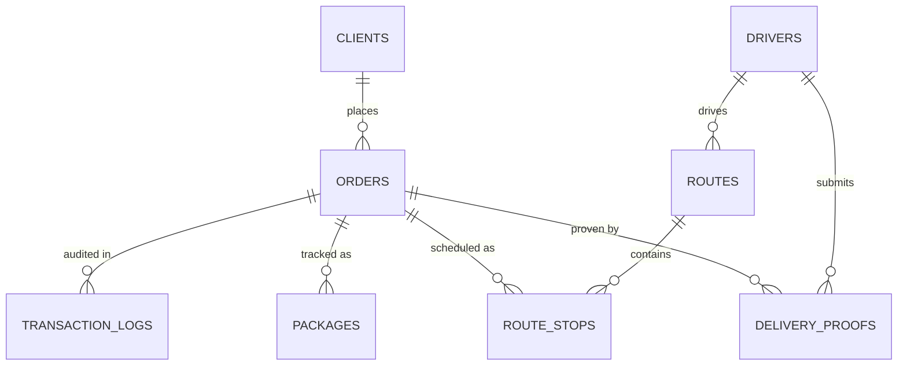

---

## 🚀 Run it yourself

You need [Docker Desktop](https://www.docker.com/products/docker-desktop/) (or Docker Engine with Compose v2) and Git.

```bash
git clone https://github.com/gayashan-indrasankha/Middleware-Architecture-for-SwiftLogistics.git
```

```bash
cd Middleware-Architecture-for-SwiftLogistics
```

```bash
docker compose up --build
```

Allow a minute or two on the first run. Then open:

| What | URL | Sign in with |
|---|---|---|
| 🖥️ Client Portal | http://localhost:8080 | `techmart@example.com` / `password123` |
| 📱 Driver Portal | http://localhost:8081 | `kasun@swiftlogistics.lk` / `password123` |
| 📨 RabbitMQ UI | http://localhost:15672 | `swift_admin` / `swift_pw_dev_only` |
| ❤️ Gateway health | http://localhost:3000/health | No login needed |

> These are local demo credentials only. Open the two portals side by side and create an order to watch the events arrive live.

<details>
<summary><b>More demo accounts and port overrides</b></summary>

<br>

All seeded accounts use the password `password123`.

| Role | Email | Notes |
|---|---|---|
| Client | `techmart@example.com` | TechMart Online (premium) |
| Client | `fashionhub@example.com` | Fashion Hub (standard) |
| Client | `homegoods@example.com` | HomeGoods Lanka (enterprise) |
| Driver | `kasun@swiftlogistics.lk` | Vehicle WP-KA-1234 |
| Driver | `nimal@swiftlogistics.lk` | Vehicle WP-NB-5678 |

If ports `3000`, `8080` or `8081` are taken, copy `.env.example` to `.env` and change the host-side ports.

| Port | Service | Protocol |
|---|---|---|
| 3000 | API Gateway | HTTP + WebSocket (`/ws`) |
| 8001 | CMS | SOAP (`/soap`) + REST |
| 8002 | ROS | REST |
| 8003 / 9000 | WMS | REST / proprietary TCP |
| 8080 / 8081 | Client / Driver Portal | HTTP |
| 5672 / 15672 | RabbitMQ | AMQP / Management UI |
| 5432 | PostgreSQL | Internal to the Docker network |

</details>

<details>
<summary><b>API reference</b></summary>

<br>

All routes except `/health` and the login endpoints need an `Authorization: Bearer <JWT>` header.

| Method | Path | Role | Description |
|---|---|---|---|
| `POST` | `/api/auth/client/login` | Public | Client login, bridged to CMS over SOAP |
| `POST` | `/api/auth/driver/login` | Public | Driver login |
| `GET` | `/api/auth/me` | Any | Current user from the token |
| `POST` | `/api/orders` | Client | Create an order and start the saga |
| `GET` | `/api/orders` | Client | List the signed-in client's orders |
| `GET` | `/api/orders/:orderCode` | Any | Order with its package, route and saga log |
| `GET` | `/api/packages/scan/:barcode` | Driver | Find a package by barcode, over TCP |
| `GET` | `/api/packages/order/:orderCode` | Client, Driver | Find a package by order, over TCP |
| `PUT` | `/api/packages/status` | Driver | Update warehouse status, over TCP |
| `GET` | `/api/driver/route/today` | Driver | Today's optimised route |
| `POST` | `/api/driver/delivery/:orderCode` | Driver | Submit proof of delivery or a failure |
| `GET` | `/api/routes` | Driver | List all routes |
| `PUT` | `/api/routes/:routeId/stops/:orderCode` | Driver | Update a stop's status |
| `GET` | `/api/saga/transactions` | Any | Recent saga steps |
| `GET` | `/api/saga/transactions/:orderCode` | Any | Saga history for one order |
| `POST` | `/api/saga/simulate-failure` | Any | Inject a failure to test compensation |

**WebSocket** at `ws://localhost:3000/ws`. Register after connecting to receive targeted events:

```json
{ "type": "register_client", "client_id": "CLT001" }
```

Events: `ORDER_CREATED`, `ROS_PROCESSING_COMPLETE`, `WMS_PROCESSING_COMPLETE`, `SAGA_TRANSACTION_SUCCESS`, `SAGA_COMPENSATED`, `DELIVERY_COMPLETED`, `PACKAGE_STATUS_UPDATED`, `ROUTE_UPDATED`, `NEW_ORDER_AVAILABLE`.

</details>

<details>
<summary><b>Project structure</b></summary>

<br>

```text
├── api-gateway/      # Auth, SOAP and TCP adapters, saga tracking, WebSocket push
├── cms-service/      # Client Management: SOAP + REST (Flask, Spyne)
├── ros-service/      # Route Optimisation: REST + RabbitMQ (Node.js)
├── wms-service/      # Warehouse Management: REST + raw TCP (Flask)
├── client-portal/    # Client web dashboard (Nginx)
├── driver-app/       # Driver mobile-first PWA (Nginx)
├── database/         # PostgreSQL schema and seed data
├── tests/            # E2E suite and WebSocket isolation test
├── .github/workflows/ # CI: runs both test suites against the full stack
├── docs/screenshots/ # Images used in this README
├── docker-compose.yml
└── ARCHITECTURE.md   # Integration pattern deep dive
```

</details>

---

## 🤝 The team

SwiftTrack was a six-person group assignment for **IS3208 Middleware Architecture**, and this repository is my fork of the [team repository](https://github.com/VMANFdo/Middleware-Architecture-for-SwiftLogistics-). Credit below follows the commit history:

| Contributor | Main contribution |
|---|---|
| **Gayashan Indrasankha** (me) | Phase 6: full-system integration, E2E test suite, cross-service bug fixes, later fixes and CI |
| **Viman Fernando** | Project planning, work distribution, documentation |
| **Vidurshan** | Database schema, Docker Compose, gateway scaffold, ROS persistence |
| **Hesara Dihindu** | Core backend services, gateway protocol bridging |
| **Yomal Kannangara** | Client portal, driver portal and PWA, JWT authentication |
| **Dilana Deepika** | Saga coordinator, WebSocket event dispatch |

---

<div align="center">

**Gayashan Indrasankha** · [GitHub](https://github.com/gayashan-indrasankha)

*Open to opportunities in backend, integration and distributed systems engineering. I'm happy to walk through any part of this project.*

</div>
